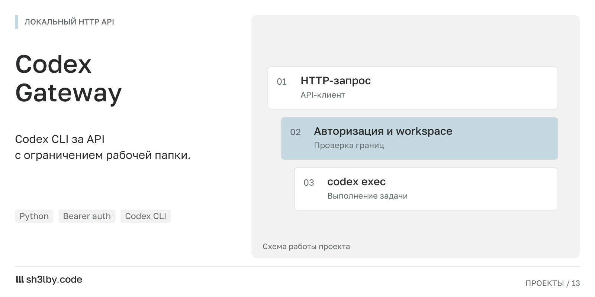

# Codex Gateway

<!-- portfolio-card:start -->
[](docs/portfolio/card.svg)
<!-- portfolio-card:end -->

Подключить бота, веб-интерфейс или скрипт к локальному Codex CLI через один HTTP API. Codex Gateway берёт на себя запуск процесса, продолжение диалога и проверку структурированных ответов. Клиент работает с сессиями и заданиями.

Для интеграций важен предсказуемый формат данных. Клиент может зарегистрировать JSON Schema и получить проверенный ответ; при невалидном JSON шлюз запрашивает исправление. Длительную задачу можно отправить в фон и опрашивать по `job_id`.

## Возможности интеграции

- Проверка состояния через `GET /health` и список моделей через `GET /models/list`.
- Создание, чтение и сброс сессий через `/sessions`, продолжение разговора по сохранённому `thread_id`.
- Текстовые ответы через `/chat` и structured JSON по схемам из `/schemas`.
- Фоновые задания через `POST /jobs` с получением состояния через `GET /jobs/{job_id}`.

Сервис рассчитан на одного владельца машины: по умолчанию слушает `127.0.0.1`, требует bearer token, ограничивает рабочие каталоги и запрещает `danger-full-access`. Сессии и схемы сохраняются локально. Авторизованный Codex CLI устанавливается отдельно.

Мотивация и архитектурный замысел: [IDEA.md](IDEA.md).

Обсудить похожий проект: [sh3l.beer](https://sh3l.beer).

## Как это устроено

Основной сценарий работы такой:

1. Клиент получает список доступных моделей через `GET /models/list`.
2. Клиент создает сессию через `POST /sessions` или позволяет `/chat` создать ее автоматически.
3. Gateway сохраняет `workspace`, `sandbox`, `model` и будущий `thread_id`.
4. При вызове `/chat` сервис запускает локальный `codex exec --json`.
   Запуск всегда принудительно использует `--ask-for-approval never`, чтобы HTTP API не зависел от интерактивных подтверждений CLI.
   У `codex exec` нет отдельного флага для system prompt, поэтому gateway сам собирает итоговый текстовый prompt и передает его в CLI как обычный `PROMPT`.
5. После создания сессии модель фиксируется в ней и повторно не переопределяется через `session_id`.
6. Ответ возвращается либо как обычная строка, либо как валидированный JSON.
7. История хранится в `.codex-api`: отдельно метаданные сессий, отдельно transcripts, отдельно схемы.

Если нужен structured output, клиент сначала регистрирует JSON Schema, получает `schema_id`, а затем передает его в `/chat`.

## Требования

- Python 3.11+ или совместимая версия с используемыми зависимостями
- установленный `codex` CLI в `PATH`
- доступ к локальному workspace внутри разрешенного root

Зависимости Python:

- `fastapi`
- `uvicorn`
- `pydantic`
- `python-dotenv`
- `jsonschema`

## Установка и запуск

```bash
cd /opt/codex-gateway
python3 -m venv .venv
source .venv/bin/activate
pip install -r requirements.txt
cp .env.example .env
python3 main.py
```

Минимально нужно задать `CODEX_API_TOKEN`. Также `main.py` завершится с ошибкой, если не найдет `codex` в `PATH`.

Без `.env` тоже работает:

```bash
cd /opt/codex-gateway
export CODEX_API_TOKEN='change-me'
python3 main.py
```

После запуска API обычно доступен по адресу `http://127.0.0.1:8765`.

## Конфигурация

Переменные окружения:

- `CODEX_API_TOKEN` - обязательный bearer token
- `CODEX_API_HOST` - host для `uvicorn`, по умолчанию `127.0.0.1`
- `CODEX_API_PORT` - порт API, по умолчанию `8765`
- `CODEX_API_ALLOWED_ROOT` - разрешенный корень workspace, по умолчанию `/srv/workspaces`
- `CODEX_API_DEFAULT_WORKSPACE` - workspace по умолчанию, если клиент его не передал
- `CODEX_API_DEFAULT_SANDBOX` - `read-only` или `workspace-write`
- `CODEX_API_MODELS_FILE` - путь до JSON-конфига с моделями, по умолчанию `models.json`
- `CODEX_API_LOG_FILE` - путь до файла логов gateway, по умолчанию `.codex-api/gateway.log`
- `CODEX_API_LOG_LEVEL` - уровень логирования, по умолчанию `INFO`
- `CODEX_API_ALLOW_NETWORK` - разрешить сетевую активность для команд, запускаемых через `codex`; по умолчанию `1`
- `CODEX_API_STATE_DIR` - директория локального состояния, по умолчанию `.codex-api`
- `CODEX_API_SCHEMA_JSON_LIMIT` - максимальный размер schema payload
- `CODEX_API_TIMEOUT_SECONDS` - timeout синхронного `/chat`
- `CODEX_API_JOB_TIMEOUT_SECONDS` - timeout фоновой job; если не задан, наследует `CODEX_API_TIMEOUT_SECONDS`

Ограничения безопасности:

- допустимые sandbox-режимы только `read-only` и `workspace-write`
- при `sandbox=read-only` gateway отклоняет запрос, если `CODEX_API_STATE_DIR` или `CODEX_API_LOG_FILE` лежат внутри целевого workspace/project
- при `sandbox=read-only` Codex запускается с изолированным `CODEX_HOME` без пользовательских MCP/plugins из обычного `~/.codex/config.toml`
- при `sandbox=workspace-write` такие записи разрешены
- `workspace` обязан лежать внутри `CODEX_API_ALLOWED_ROOT`
- токен требуется для всех endpoint, кроме `/health`
- одновременные запросы в одну и ту же сессию блокируются, второй запрос получит `409`
- неизвестные поля запроса игнорируются для совместимости

Пример конфигурации моделей:

```json
{
  "models": ["gpt-5-codex", "custom-a", "custom-b"],
  "default_model": "custom-a"
}
```

По умолчанию gateway читает этот файл из [models.json](models.json). При необходимости путь можно переопределить через `CODEX_API_MODELS_FILE`.

Логи gateway по умолчанию пишутся в `.codex-api/gateway.log`. Там фиксируются:

- итоговый prompt, который gateway отправляет в `codex`
- параметры запуска CLI
- финальный ответ модели
- ошибки и timeout`ы `codex`

Если нужен реальный `sandbox=read-only` для текущего проекта, вынесите `CODEX_API_STATE_DIR` и `CODEX_API_LOG_FILE` за пределы этого workspace. Иначе gateway вернет `409` и не запустит такой запрос.

## Локальное состояние

По умолчанию сервис пишет данные в `.codex-api`:

- `.codex-api/sessions/*.json` - метаданные сессий
- `.codex-api/transcripts/*.md` - накопленные transcript-файлы
- `.codex-api/schemas/*.json` - зарегистрированные JSON Schema
- `.codex-api/jobs/*.json` - статусы и результаты фоновых задач

`POST /sessions/{session_id}/reset` сбрасывает только `thread_id`. Сама сессия, workspace и transcript при этом остаются.

## API

### `GET /health`

Проверка доступности процесса.

Пример ответа:

```json
{
  "status": "ok",
  "codex_bin": "/usr/bin/codex",
  "allowed_root": "/srv/workspaces"
}
```

### `POST /schemas`

Регистрирует JSON Schema для будущего structured output.

Пример запроса:

```json
{
  "name": "brief-answer",
  "description": "Short structured response",
  "schema": {
    "type": "object",
    "properties": {
      "status": { "type": "string" },
      "answer": { "type": "string" }
    },
    "required": ["status", "answer"],
    "additionalProperties": false
  }
}
```

Пример ответа:

```json
{
  "schema_id": "a3f0...",
  "schema": {
    "type": "object",
    "properties": {
      "status": { "type": "string" },
      "answer": { "type": "string" }
    },
    "required": ["status", "answer"],
    "additionalProperties": false
  },
  "name": "brief-answer",
  "description": "Short structured response",
  "created_at": "2026-03-17T10:00:00+00:00",
  "updated_at": "2026-03-17T10:00:00+00:00"
}
```

### `GET /schemas/{schema_id}`

Возвращает сохраненную схему.

### `POST /sessions`

Создает сессию заранее.

Тело запроса:

```json
{
  "workspace": "/opt/codex-gateway",
  "model": "gpt-5-codex",
  "sandbox": "workspace-write"
}
```

Все поля optional. Если их не передать, будут использованы значения по умолчанию из конфигурации.
Если `model` передан, он должен присутствовать в allowlist из JSON-конфига моделей.
Если `sandbox` не передан, используется `CODEX_API_DEFAULT_SANDBOX`.

Пример ответа:

```json
{
  "session_id": "2ef7...",
  "workspace": "/opt/codex-gateway",
  "model": "gpt-5-codex",
  "sandbox": "workspace-write",
  "thread_id": null,
  "created_at": "2026-03-17T10:00:00+00:00",
  "updated_at": "2026-03-17T10:00:00+00:00"
}
```

### `GET /sessions/{session_id}`

Возвращает текущее состояние сессии.

### `GET /models/list`

Возвращает список моделей, которые можно выбрать при создании сессии.
Endpoint читает allowlist из JSON-конфига, заданного через `CODEX_API_MODELS_FILE`.

Пример ответа:

```json
{
  "models": ["gpt-5-codex", "custom-a", "custom-b"],
  "default_model": "custom-a"
}
```

### `POST /sessions/{session_id}/reset`

Сбрасывает `thread_id`, чтобы следующий `/chat` начал новый тред внутри той же сессии.

### `POST /chat`

Главный endpoint проекта.

Поддерживает два режима:

- `response_format: "raw"` - обычная строка в `reply`
- `response_format: "json"` - JSON object или array в `reply`, валидированный по схеме

Поля запроса:

- `message` - обязательная строка
- `system_prompt` - optional системная инструкция только для `response_format="raw"`
- `session_id` - использовать существующую сессию
- `workspace`, `model`, `sandbox` - допустимы только если `session_id` не передан
- `response_format` - `raw` или `json`, по умолчанию `raw`
- `schema_id` - обязателен для `response_format="json"`
- `chat_context` - дополнительный inline-контекст; может быть строкой, объектом или массивом

Если `session_id` не указан, `/chat` сам создаст новую сессию и вернет `created_session: true`.
Если `model` указан в таком запросе, он должен присутствовать в `GET /models/list`.
Если `session_id` указан, передавать `model` нельзя: используется модель, уже сохраненная в сессии.
Если `sandbox="read-only"`, gateway сначала проверяет, что его собственные state/log paths не попадают в целевой workspace, и только потом запускает Codex.
Для таких запусков gateway использует отдельный `CODEX_HOME` внутри своего state dir и копирует туда только `auth.json`, без пользовательского `config.toml`, MCP и plugin-конфига.
Если `system_prompt` указан, gateway добавляет его к raw prompt текущего запроса, но не сохраняет в сессии.
`system_prompt` не передается в `codex` отдельным CLI-флагом и не становится отдельным system-channel сообщением: gateway встраивает его в начало общего raw prompt.
Если `codex` упирается в реальный лимит модельного контекста, API вернет `413`.
Для resumed session это обычно означает, что переполнен накопленный thread-контекст: в таком случае нужно уменьшить новый inline-контекст или вызвать `POST /sessions/{session_id}/reset`.

Форма итогового raw prompt такая:

```text
System prompt:
...

Chat context:
...

User request:
...
```

Если у сессии уже есть `thread_id`, этот собранный prompt уходит в `codex resume` как очередной ввод в существующую сессию.

Пример raw-запроса:

```bash
curl -X POST http://127.0.0.1:8765/chat \
  -H 'Authorization: Bearer change-me' \
  -H 'Content-Type: application/json' \
  -d '{
    "message": "Сделай краткий обзор репозитория",
    "workspace": "/opt/codex-gateway"
  }'
```

Пример raw-ответа:

```json
{
  "session_id": "2ef7...",
  "thread_id": "thread-123",
  "reply": "Краткий обзор...",
  "workspace": "/opt/codex-gateway",
  "model": null,
  "sandbox": "workspace-write",
  "duration_ms": 8421,
  "created_session": true,
  "output_mode": "raw",
  "used_schema_id": null,
  "validation_retries": 0
}
```

Пример structured-запроса:

```bash
curl -X POST http://127.0.0.1:8765/chat \
  -H 'Authorization: Bearer change-me' \
  -H 'Content-Type: application/json' \
  -d '{
    "message": "Сделай краткий обзор репозитория",
    "workspace": "/opt/codex-gateway",
    "response_format": "json",
    "schema_id": "PUT_SCHEMA_ID_HERE",
    "chat_context": {
      "audience": "owner",
      "style": "brief"
    }
  }'
```

Пример structured-ответа:

```json
{
  "session_id": "2ef7...",
  "thread_id": "thread-456",
  "reply": {
    "status": "ok",
    "answer": "Short answer"
  },
  "workspace": "/opt/codex-gateway",
  "model": null,
  "sandbox": "workspace-write",
  "duration_ms": 9134,
  "created_session": true,
  "output_mode": "json",
  "used_schema_id": "PUT_SCHEMA_ID_HERE",
  "validation_retries": 1
}
```

### `POST /jobs`

Ставит агентную задачу в фон и сразу возвращает `job_id`.

Тело запроса совпадает с `/chat`. Можно передавать:

- `session_id` для продолжения существующей сессии
- либо `workspace` и прочие параметры для создания новой
- `system_prompt` для одноразовой системной инструкции в raw-режиме
- `response_format: "raw"` или `response_format: "json"`
- `schema_id`, если нужен structured output

Для новой фоновой сессии `model` тоже можно передать в запросе, но она должна входить в `GET /models/list`.
Если передан `session_id`, модель берется из существующей сессии и не переопределяется.

Пример запроса:

```bash
curl -X POST http://127.0.0.1:8765/jobs \
  -H 'Authorization: Bearer change-me' \
  -H 'Content-Type: application/json' \
  -d '{
    "message": "Пройди по проекту, проверь код и предложи план улучшений",
    "workspace": "/opt/codex-gateway"
  }'
```

Пример ответа:

```json
{
  "job_id": "9cf1...",
  "status": "queued",
  "session_id": "2ef7...",
  "thread_id": null,
  "reply": null,
  "workspace": "/opt/codex-gateway",
  "model": null,
  "sandbox": "workspace-write",
  "duration_ms": null,
  "created_session": true,
  "output_mode": "raw",
  "used_schema_id": null,
  "validation_retries": 0,
  "error": null,
  "submitted_at": "2026-03-17T10:00:00+00:00",
  "started_at": null,
  "finished_at": null,
  "updated_at": "2026-03-17T10:00:00+00:00"
}
```

### `GET /jobs/{job_id}`

Возвращает текущее состояние фоновой задачи.

Статусы:

- `queued`
- `running`
- `completed`
- `failed`

Если задача завершилась успешно, в `reply` будет тот же payload, который `/chat` вернул бы синхронно. Если завершилась ошибкой, поле `error` будет содержать нормализованную причину.
Для переполненного контекста фоновые задачи возвращают `error.code="context_too_large"` без retry.

## Типовой сценарий

1. Вызвать `GET /models/list` и показать пользователю доступные модели.
2. Создать сессию через `POST /sessions` с нужной `model`.
3. Продолжать диалог через `POST /chat` или `POST /jobs`, передавая только `session_id`.
4. Если нужна другая модель, создать новую сессию вместо переиспользования старой.

## Structured output

Когда `response_format="json"`, gateway делает больше, чем просто прокидывает prompt:

- добавляет инструкцию вернуть только JSON;
- подмешивает зарегистрированную JSON Schema;
- валидирует ответ через `jsonschema`;
- при ошибке пытается скорректировать ответ до `2` раз;
- возвращает количество corrective retries в `validation_retries`.

Ошибка может произойти по трем основным причинам:

- модель вернула не JSON;
- JSON не прошел schema validation;
- ответ оказался пустым или unusable.

В этих случаях API возвращает ошибку уровня `502`, если даже после retry валидный результат собрать не удалось.

## Ошибки

Типовые статусы:

- `401` - отсутствует или неверный bearer token
- `403` - workspace вне разрешенного root
- `404` - сессия или схема не найдена
- `409` - сессия уже занята другим запросом
- `409` - read-only запрос конфликтует с `CODEX_API_STATE_DIR` или `CODEX_API_LOG_FILE` внутри target workspace
- `413` - слишком большой schema payload или переполненный модельный/session context
- `422` - невалидный запрос или неподдерживаемый sandbox
- `502` - модель вернула невалидный structured output
- `503` - не удалось выполнить `codex`

Для части ошибок сервис возвращает нормализованный payload:

```json
{
  "code": "codex_unavailable",
  "message": "backend failed",
  "retryable": true
}
```

## Разработка и тесты

Запуск тестов:

```bash
python3 -m unittest discover -s tests -p 'test_api.py'
```

Для локальной разработки достаточно менять код в `codex_gateway/` и запускать сервис через `python3 main.py`.

Практический дефолт для средних задач:

- `CODEX_API_TIMEOUT_SECONDS=1200`
- `CODEX_API_JOB_TIMEOUT_SECONDS=1800`

Такой профиль удобен, если короткие запросы остаются синхронными, а более долгие агентные прогоны уходят через `/jobs`.
